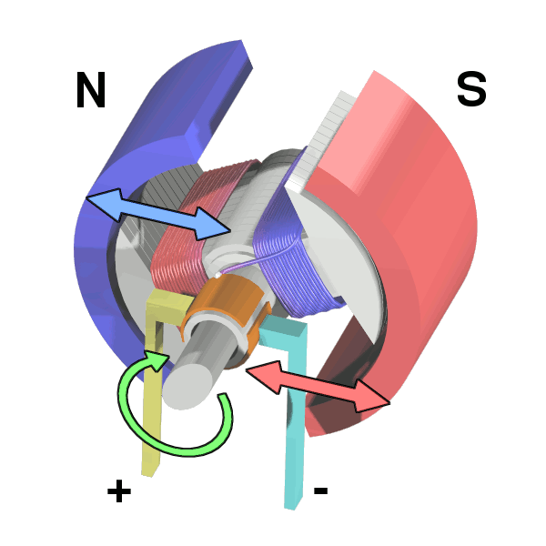
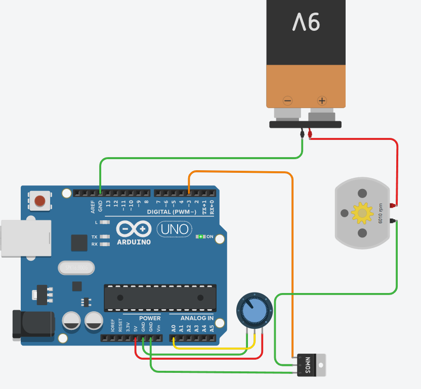
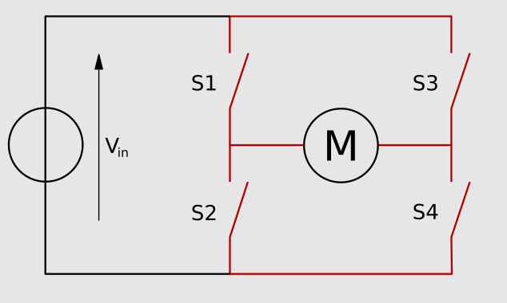
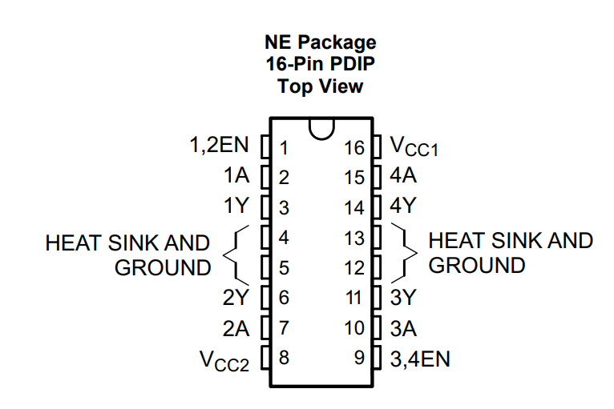
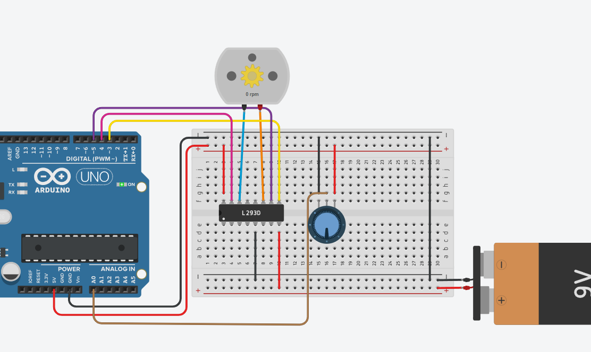

# Alalisvoolumootorid

Alalisvoolumootorid *(ingl Direct Current motor, DC-motor)* on elektromehaanilised seadmed, mis muundavad alalisvoolu elektrienergia pöörlevaks liikumiseks. Need mootorid töötavad magnetvälja ja elektrivoolu vastastikmõju põhimõttel ([Lorentzi jõud](https://et.wikipedia.org/wiki/Lorentzi_j%C3%B5ud)), kus rootor hakkab pöörlema, kui vool läbib mootori mähiseid. Alalisvoolumootoreid leidub mitmesugustes seadmetes, alates mänguasjadest kuni tööstusautomaatika lahendusteni. Arduino UNO-ga juhitavad alalisvoolumootorid on tavaliselt harjadega alalisvoolumootorid *(ingl Brushed DC-motor)*. Harjadega alalisvoolumootori täpsema tööpõhimõtte kohta saad lugeda [siit.](https://en.wikipedia.org/wiki/Brushed_DC_electric_motor)

*Allikas: https://commons.wikimedia.org/wiki/File:Electric_motor_cycle_3.png*

Alalisvoolumootori juhtimiseks Arduino UNO-ga kasutatakse tavaliselt [transistoripõhist](https://github.com/nullyks/Arduino-baaselemendid/blob/main/materjalid/3_transistorid.md) lülitust või mootoridraiverit, näiteks L293D. Need draiverid võimaldavad mootori suunda ja kiirust reguleerida PWM-signaali abil. PWM-signaal lülitab mootoridraiverit kiiresti sisse ja välja. PWM-signaali töötsükli muutmine muudab mootorile rakenduvat keskmist pinget ja võimsust ning seeläbi tavaliselt mootori pöörlemiskiirust. Arduino UNO PWM-viikudest rääkisime [siin.](https://github.com/nullyks/Arduino-sissejuhatus/blob/main/materjalid/3_Arduino_UNO_viigud.md) Mootori pöörlemissuuna muutmiseks kasutatakse H-silda, mis vahetab voolu suunda mähistes. Mõned mootorid on varustatud enkoodritega, mis võimaldavad täpsemat kiiruse ja asendi juhtimist.

Arduino UNO suudab genereerida juhtsignaale, kuid ei suuda pakkuda enamikule mootoritele piisavalt voolu. Seetõttu tuleb mootori voolu lülitamiseks kasutada sobivat transistorlülitust või mootoridraiverit. Mootori toitepinge valitakse mootori nimipinge ja draiveri lubatud pingevahemiku järgi. Toiteallikas peab suutma anda vähemalt mootori seiskumisvoolule vastavat voolu. Välise toiteallika miinusklemm, Arduino GND ning transistorlülituse või mootoridraiveri GND tuleb omavahel ühendada.

## Alalisvoolumootori juhtimine MOSFET-transistoriga

Kõige lihtsamal juhul saame alalisvoolumootorit juhtida ühe MOSFET-[transistoriga](https://github.com/nullyks/Arduino-baaselemendid/blob/main/materjalid/3_transistorid.md). Ühest transistorist piisab mootori toiteahela lülitamiseks. PWM-signaali abil saab muuta mootori keskmist võimsust ja seeläbi selle pöörlemiskiirust, kuid mitte pöörlemissuunda. Näites saab kasutaja mootori pöörlemiskiiruse määrata potentsiomeetri asendiga. Näites kasutame N-kanaliga MOSFET-transistorit.

Kasuta loogikatasemega N-kanaliga MOSFET-transistorit, mille väike sisselülitustakistus on andmelehel määratud umbes 4,5–5 V paisupinge juures, näiteks IRLZ44N.

### Ühe MOSFET-transistoriga juhtimise näide

**Märkus.** Skeemil kujutatud 9 V plokkpatarei on näitlik. Tavaline 9 V plokkpatarei ei sobi üldjuhul mootori praktiliseks toitmiseks, sest selle vooluandmisvõime on väike ja pinge võib koormuse all tugevalt langeda. Füüsilises vooluahelas tuleb kasutada mootori nimipingele ja seiskumisvoolule vastavat toiteallikat.

**Märkus.** Skeemi lihtsustamiseks ei ole joonisel näidatud mootori kaitsedioodi. Füüsilises vooluahelas tuleb harjadega alalisvoolumootori klemmidega ühendada rööbiti kaitsediood: dioodi katood ehk triibuga ots mootori toiteplussi ja anood MOSFET-i-poolse klemmi külge. Diood vähendab MOSFET-i väljalülitamisel tekkiva induktiivse pingelöögi ohtu.

Samuti on skeemi lihtsustamiseks välja jäetud MOSFET-i paisu ja GND vahele ühendatav 10 kΩ tõmbetakisti. Füüsilises vooluahelas on soovitatav see lisada, et hoida MOSFET ja mootor Arduino käivitumise või lähtestamise ajal väljalülitatuna.

~~~cpp
#define gate 3 //selle viigu abil kontrollime MOSFET-i
#define pot A0 //selle viigu abil loeme potentsiomeetri asendi

void setup() {
	Serial.begin(9600);
    pinMode(gate, OUTPUT);
}

void loop() {
	int potValue=analogRead(pot); //loeme potentsiomeetri väärtuse
    int motorValue=map(potValue,0,1023,0,255); //vastendame loetud väärtuse MOSFETi juhtimiseks sobivasse vahemikku
    Serial.println(motorValue);
    analogWrite(gate, motorValue); //motorValue määrab MOSFET-i juhtiva PWM-signaali töötsükli
}
~~~
[Interaktiivne simulatsioon](https://www.tinkercad.com/things/aAgbmGxxBCX-alalisvoolumootor-transistoriga?sharecode=Arc8_eGUyrxYSLrNBUmZmxTYQaNH4XsKgko5yd7moFY)

## Alalisvoolumootori juhtimine L293D draiveriga
Ühe MOSFET-transistoriga lülitus võimaldab muuta mootori kiirust, kuid mitte pöörlemissuunda. Pöörlemissuuna muutmiseks kasutatakse H-silda, mis sisaldub näiteks L293D mootoridraiveris.
H-sild on vooluahel, mis võimaldab alalisvoolumootori pöörlemissuunda muuta, juhtides seda, millises suunas toitevool mootori läbib.

See koosneb tavaliselt neljast transistorist või lülitist, mis on paigutatud H-kujuliselt – sellest ka nimetus H-sild. Kui kaks diagonaalis olevat transistori sisse lülitada, voolab vool läbi mootori ühes suunas, ja kui sisse lülitatakse teised kaks, pöördub voolu suund, muutes mootori pöörlemissuunda.

*(Allikas: https://commons.wikimedia.org/wiki/File:H_bridge.svg)*

Tabelis tähendab `1`, et vastav lüliti on suletud ehk juhib voolu, ning `0`, et lüliti on avatud ega juhi voolu.

| S1 | S2| S3 | S4 | Tulemus |
|:---:|:---:|:---:|:---:|:---|
| 1 | 0| 0 | 1 | Mootor pöörleb paremale |
| 0 | 1| 1 | 0 | Mootor pöörleb vasakule |
| 0 | 0| 0 | 0 | Mootor veereb vabalt |
| 0 | 1| 0 | 1 | Dünaamiline pidurdus: mootori mõlemad klemmid on ühendatud GND-ga |
| 1 | 0| 1 | 0 | Dünaamiline pidurdus: mootori mõlemad klemmid on ühendatud toiteplussiga |
| 1 | 1| 0 | 0 | Lühis |
| 0 | 0| 1 | 1 | Lühis |
| 1 | 1| 1 | 1 | Lühis |

**NB!** Lühisena märgitud kombinatsioone ei tohi kasutada. Nende korral ühendatakse toitepluss ja GND sama sillaharu kaudu otse kokku, mis võib kahjustada lüliteid, draiverit või toiteallikat.

L293D mootoridraiver sisaldab kahte H-silda, mistõttu saab sellega juhtida korraga kahte mootorit teineteisest sõltumatult. See sobib näiteks roomik- ja kaherattaliste liikurplatvormide jaoks, mille vedavad rattad paiknevad vastaskülgedel.

### L293D ühendusskeem

*Allikas: https://www.ti.com/lit/ds/symlink/l293.pdf*

* **VCC1** - draiveri enda toide 5 V
* **VCC2** - mootorite toide 4,5–36 V
* **1,2EN** - vasakpoolse mootori sisselülitus (PWM-iga saab juhtida kiirust)
* **3,4EN** - parempoolse mootori sisselülitus (PWM-iga saab juhtida kiirust)
* **1Y** - vasakpoolse mootori üks klemm
* **2Y** - vasakpoolse mootori teine klemm
* **1A ja 2A** - juhivad vasakpoolse mootori suunda. Vastupidised loogikatasemed panevad mootori pöörlema; sama loogikatase mõlemal sisendil peatab mootori.
* **3Y** - parempoolse mootori üks klemm
* **4Y** - parempoolse mootori teine klemm
* **3A ja 4A** - juhivad parempoolse mootori suunda. Vastupidised loogikatasemed panevad mootori pöörlema; sama loogikatase mõlemal sisendil peatab mootori.
* **viigud 4,5,12,13** - maandus

**NB!** L293D ühe väljundkanali lubatud pidevvool on kuni 600 mA. Kuna ühe mootori juhtimiseks kasutatakse kahte kanalit, peab ka mootori pidev vool jääma alla 600 mA. Mootoridraiver tuleb valida mootori seiskumisvoolu järgi ning arvestada tuleb ka kiibi soojenemisega. Andmelehel nimetatud 1,2 A on üksnes väga lühiajaline tippvool, mitte lubatud pidev töövool.

L293D väljunditel tekib koormuse all pingelang, mistõttu võib mootori klemmipinge olla toitepingest mitu volti madalam. Arvesta sellega mootori toitepinge valimisel ja jälgi draiveri soojenemist.

### L293D draiveriga mootori juhtimise näide

Mootori pöörlemise suunda ja kiirust kontrollib [potentsiomeeter](https://github.com/nullyks/Arduino-baaselemendid/blob/main/materjalid/1_takistid.md). Keskmises asendis mootor seisab. Mida rohkem paremale on potentsiomeeter, seda kiiremini paremale mootor pöörleb ja mida rohkem vasakule on potentsiomeeter, seda kiiremini vasakule mootor pöörleb.

**Märkus.** Skeemil kujutatud 9 V plokkpatarei on näitlik. Füüsilises vooluahelas tuleb kasutada mootorite nimipingele ja mõlema mootori seiskumisvoolule vastavat toiteallikat ning jälgida, et L293D lubatud voolu ei ületataks.

**Märkus.** Skeemi lihtsustamiseks ei ole joonisel näidatud toite möödaviigukondensaatoreid. Füüsilises vooluahelas on soovitatav ühendada vähemalt 0,1 µF kondensaator nii VCC1- kui ka VCC2-viigu ja GND vahele võimalikult L293D lähedale.

~~~cpp
#define pot A0 //selle viigu kaudu loeme potentsiomeetri asendi
#define kiirus 3 //see viik määrab mootori kiiruse
// Need viigud määravad mootori pöörlemissuuna
#define suund1 4
#define suund2 5

void setup()
{
  pinMode(kiirus, OUTPUT);
  pinMode(suund1, OUTPUT);
  pinMode(suund2, OUTPUT);
}

void loop()
{
  int potData=analogRead(pot); //loeme poteka väärtuse
  if(potData<500){ // kui väärtus on väiksem kui 500, siis pöörleb mootor vasakule
    digitalWrite(suund1, HIGH);
    digitalWrite(suund2, LOW);
    int mapValue=map(potData,0,499,255,0); // mida väiksem poteka näit seda suurem kiirus
    analogWrite(kiirus,mapValue);
  }
  if(potData>=500 && potData<=520){ //kui potekas on vahemikus 500 - 520, siis mootor seisab
     analogWrite(kiirus,0);
  }
  if(potData>520){ //kui potekas väärtus on üle 520, siis mootor pöörleb paremale
    digitalWrite(suund1, LOW);
    digitalWrite(suund2, HIGH);
    int mapValue=map(potData,521,1023,0,255); //mida suurem poteka näit, seda suurem kiirus
    analogWrite(kiirus,mapValue);
  }
}
~~~

[Interaktiivne simulatsioon](https://www.tinkercad.com/things/fjxmPUpN59m-l293d?sharecode=uxteCFtOcrfE4VWT_eUc0wMcFpKebon9JHcF5isJFJo)

## Alalisvoolumootori juhtimine DRV8833 mooduliga

[DRV8833](https://www.ti.com/product/DRV8833) on kahe H-sillaga mootoridraiver, millega saab juhtida kaht harjadega alalisvoolumootorit või üht bipolaarset samm-mootorit. Selles näites kasutame [12 viiguga DRV8833 moodulit](https://components101.com/modules/drv8833-dual-h-bridge-motor-driver-module) ja juhime selle ühe H-sillaga üht alalisvoolumootorit. Mootori pöörlemissuunda ja kiirust määrab potentsiomeetri asend nagu eelnevas L293D näites.

DRV8833 kiibi tööpinge on 2,7–10,8 V ning lingitud mooduli kirjelduses on VCC-viigu vahemikuks märgitud 2,8–10,8 V. Selles näites kasutame konservatiivset ja lihtsalt meeldejäävat vahemikku 3–10 V. Vali toitepinge alati nii mootori nimipinge kui ka mooduli lubatud pinge järgi.

### DRV8833 ja L293D võrdlus

Mõlemad draiverid sisaldavad kaht H-silda, võimaldavad juhtida kahte harjadega alalisvoolumootorit ja vajavad Arduino ning mootori toiteallika vahele ühist GND-ühendust. Nende ehitus ja kasutusomadused on aga üsna erinevad.

| Omadus | L293D | DRV8833 moodul |
|:---|:---|:---|
| Mootori toitepinge | 4,5–36 V | Kiibi töövahemik 2,7–10,8 V; lingitud mooduli VCC-viigu kirjelduses 2,8–10,8 V. Näites kasutame 3–10 V. |
| Väljundaste | Bipolaartransistorid | MOSFET-transistorid |
| Pingelang ja kasutegur | Väljunditel võib koormuse all tekkida mitmevoldine pingelang. 600 mA juures on ühe H-silla tüüpiline kogupingelang andmelehe väärtuste põhjal umbes 2,6 V, mistõttu osa energiast muutub draiveris soojuseks. | Ühe H-silla ülemise ja alumise MOSFET-i tüüpiline summaarne sisselülitustakistus on 360 mΩ. 600 mA juures vastab see ligikaudu 0,22 V pingelangule, kuid tegelik väärtus kasvab temperatuuri tõustes. Väiksem pingelang on eriti kasulik väikese toitepingega mootorite puhul. |
| Voolutaluvus | Kuni 600 mA pidevvoolu ühe kanali kohta; 1,2 A tippvool on lubatud kuni 100 µs. | Kiibi PWP- ja RTY-korpuse kohta on 5 V ning 25 °C juures antud 1,5 A efektiivväärtus ja 2 A tippvool H-silla kohta, kuid PW-korpuse efektiivväärtus on ainult 500 mA. Mooduli tegelik pidevvool sõltub ka trükkplaadist ja jahutusest. |
| Loogikatoide | Vajab eraldi 5 V loogikatoidet VCC1 ning mootori toidet VCC2. | Moodulil on üks VCC toitesisend mootori ja draiveri jaoks. Arduino ühendatakse juhtsisendite ning ühise GND kaudu; Arduino 5 V viiku ei ühendata VCC-ga. |
| Kiiruse ja suuna juhtimine | Suunda juhivad kaks sisendit ning kiirust eraldi EN-viigule antav PWM-signaal. | Iga mootori mõlemad IN-sisendid määravad nii suuna kui ka kiiruse. PWM-signaal antakse parasjagu aktiivsele IN-sisendile. |
| Peatumisviisid | EN-viigu väljalülitamisel on väljundid suure impedantsiga; mõlema suunasisendi sama tasemega saab kasutada pidurdamist. | `IN1 = LOW` ja `IN2 = LOW` laseb mootoril vabalt veereda; mõlemad sisendid HIGH rakendavad dünaamilise pidurduse. |
| Unerežiim | Eraldi unerežiimi sisend puudub. | EEP ehk nSLEEP võimaldab kogu draiveri väikese energiatarbega unerežiimi panna. |
| Kaitsed ja veateade | Sisemised kaitsedioodid ja termokaitse, kuid puudub eraldi veaväljund. | Ülevoolu-, lühise-, alapinge- ja ületemperatuurikaitse ning aktiiv-madal ULT ehk nFAULT veaväljund. |
| Kaitsedioodid | L293D sisaldab induktiivkoormuse kaitsedioode. | MOSFET H-sild võimaldab mootori induktiivvoolu sisemist vabajooksu; eraldi kaitsedioode tavaliselt ei lisata. Mõlemal juhul on toite möödaviigu- ja puhverdamiskondensaatorid siiski olulised. |
| Füüsiline kasutamine | 16 viiguga DIP-korpus sobib otse makettplaadile. | Kompaktne moodul säästab ruumi, kuid ühendusviigud tuleb tavaliselt mooduli külge joota ja makettplaadile on vaja rohkem ühendusjuhtmeid. |
| Millal eelistada? | Kui mootori toitepinge on üle 10,8 V, kuid ei ületa 36 V, ja mootori vool jääb L293D piiridesse. | Väikese pingega aku- ja robotiprojektides, kus väiksem pingelang, parem kasutegur, kaitsed ja kompaktne moodul on olulised. |

DRV8833 ei ole seega alati L293D asendus. Näiteks 12 V mootori jaoks DRV8833 ei sobi, sest selle suurim lubatud toitepinge on 10,8 V. Samuti ei tohi ainult mooduli reklaamis nimetatud tippvoolu põhjal eeldada, et moodul suudab sama suurt voolu pidevalt juhtida.

### DRV8833 mooduli viigud

Selle näite moodulil on 12 ühendusviiku. Trükkplaadile märgitud lühendid `EEP` ja `ULT` tähistavad vastavalt DRV8833 kiibi nSLEEP- ja nFAULT-signaali.

| Viik | Otstarve |
|:---|:---|
| **VCC** | Mootori ja draiveri väline toide, selle mooduli puhul 3–10 V |
| **GND** | Toiteallika, mooduli ja Arduino ühine maandus |
| **IN1, IN2** | Esimese H-silla juhtsisendid; juhivad OUT1 ja OUT2 väljundeid |
| **OUT1, OUT2** | Esimese mootori ühendused |
| **IN3, IN4** | Teise H-silla juhtsisendid; juhivad OUT3 ja OUT4 väljundeid |
| **OUT3, OUT4** | Teise mootori ühendused |
| **EEP (nSLEEP)** | Aktiiv-madal unerežiimi sisend: LOW lülitab draiveri unerežiimi, HIGH lubab töö. Mooduli J2 jootesild võib hoida selle sisendi vaikimisi tööolekus. |
| **ULT (nFAULT)** | Aktiiv-madal avatud neeluga veaväljund. Vea korral muutub signaal LOW-tasemeks. Lihtsas näites võib selle ühendamata jätta; vea lugemiseks on vaja tõmbetakistit või Arduino sisemist tõmmet. |

Kontrolli enne ühendamist oma mooduli J2 jootesilda. Kui J2 on ühendatud, võib EEP-viigu selles näites ühendamata jätta. Kui J2 on katkestatud, peab EEP olema töö ajal HIGH-tasemel. Ära ühenda EEP-viiku pimesi Arduino 5 V viiguga: mõnel moodulil võib J2 siduda selle juba mooduli VCC-pingega. Lähtu konkreetse mooduli skeemist ja märgistusest.

### Ühe mootori ühendamine

| DRV8833 mooduli viik | Ühendus selles näites |
|:---|:---|
| **VCC** | Mootorile sobiva 3–10 V välise toiteallika plussklemm |
| **GND** | Välise toiteallika miinusklemm ja Arduino GND |
| **OUT1, OUT2** | Alalisvoolumootori kaks klemmi |
| **IN1** | Arduino digitaalviik D5 |
| **IN2** | Arduino digitaalviik D6 |
| **EEP** | Jäta ühendamata ainult siis, kui J2 jootesild hoiab draiveri tööolekus |
| **ULT** | Selles lihtsas näites ühendamata |
| **IN3, IN4** | Kasutamata; kindla oleku tagamiseks võib ühendada GND-ga |

Potentsiomeetri äärmised viigud ühendatakse Arduino 5 V ja GND-ga ning keskmine viik analoogsisendiga A0. Arduino D5 ja D6 on mõlemad PWM-võimelised viigud.

**Märkus.** Mootorit ei toideta Arduino 5 V viigust. Väline toiteallikas ühendatakse mooduli VCC- ja GND-viiguga ning Arduino GND ühendatakse sama GND-ga, et juhtsignaalidel oleks ühine võrdlusnivoo.

**Märkus.** Draiveri lähedal peab olema toite möödaviigukondensaator. Moodulil on tavaliselt vajalikud väikesed kondensaatorid juba olemas, kuid kontrolli seda oma moodulilt. Pikkade toitejuhtmete või ebastabiilse toite korral lisa mooduli VCC ja GND vahele sobiv puhverdamiskondensaator.

**NB!** Vali draiver ja toiteallikas mootori seiskumisvoolu järgi. DRV8833 andmelehel nimetatud suurimad voolud sõltuvad kiibi korpusest ja jahutusest ning 2 A väärtus on tippvool. Kui moodul muutub kuumaks või termokaitse hakkab väljundit korduvalt välja lülitama, tuleb koormust vähendada või valida suurema voolutaluvusega draiver.

### Sisendite loogikatabel

| IN1 | IN2 | Mootori olek |
|:---:|:---:|:---|
| LOW | LOW | Väljundid on suure impedantsiga ja mootor veereb vabalt |
| HIGH | LOW | Mootor pöörleb ühes suunas |
| LOW | HIGH | Mootor pöörleb vastassuunas |
| HIGH | HIGH | Dünaamiline pidurdus |

Kui mootori tegelik pöörlemissuund ei vasta tekstis nimetatud suunale, vaheta omavahel OUT1 ja OUT2 ühendused. Kiiruse muutmiseks antakse PWM-signaal selle suuna sisendile, milles mootor peab pöörlema, ning teine sisend hoitakse LOW-tasemel.

### Juhtimisprogramm

Keskmises asendis on potentsiomeetri väärtusele jäetud väike surnud ala, et mootor ei hakkaks mõõtemüra tõttu edasi-tagasi võbelema. Surnud alas seatakse mõlemad sisendid LOW-tasemele ja mootor saab vabalt peatuda.

~~~cpp
const int POT_VIIK = A0;
const int IN1_VIIK = 5;
const int IN2_VIIK = 6;

const int KESKALA_ALGUS = 500;
const int KESKALA_LOPP = 520;

void setup()
{
  pinMode(IN1_VIIK, OUTPUT);
  pinMode(IN2_VIIK, OUTPUT);

  digitalWrite(IN1_VIIK, LOW);
  digitalWrite(IN2_VIIK, LOW);
}

void loop()
{
  int potentsiomeeter = analogRead(POT_VIIK);

  if (potentsiomeeter < KESKALA_ALGUS) {
    // Kõigepealt lülitame vastassuuna sisendi välja.
    digitalWrite(IN2_VIIK, LOW);
    int pwmVaartus = map(potentsiomeeter, 0, KESKALA_ALGUS - 1, 255, 0);
    analogWrite(IN1_VIIK, pwmVaartus);
  }
  else if (potentsiomeeter > KESKALA_LOPP) {
    // Kõigepealt lülitame vastassuuna sisendi välja.
    digitalWrite(IN1_VIIK, LOW);
    int pwmVaartus = map(potentsiomeeter, KESKALA_LOPP + 1, 1023, 0, 255);
    analogWrite(IN2_VIIK, pwmVaartus);
  }
  else {
    // Mõlemad sisendid LOW: mootor veereb vabalt peatumiseni.
    digitalWrite(IN1_VIIK, LOW);
    digitalWrite(IN2_VIIK, LOW);
  }
}
~~~

Koodis ei lülitata pöörlemissuunda otse ühelt suunalt teisele: enne uue suuna PWM-signaali rakendamist seatakse teine sisend LOW-tasemele. Mootori mehaanilise koormuse säästmiseks võib päris rakenduses lisada suunavahetuse eel lühikese peatumise või vähendada kiirust astmeliselt.

DRV8833 täpsed elektrilised piirväärtused ja kaitsete käitumine on toodud [Texas Instrumentsi andmelehel](https://www.ti.com/lit/ds/symlink/drv8833.pdf).
