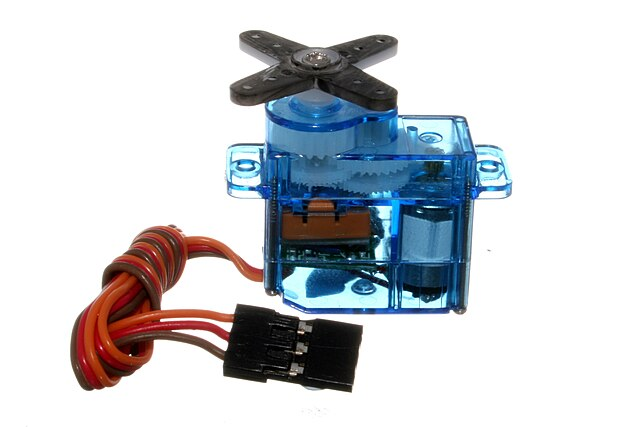
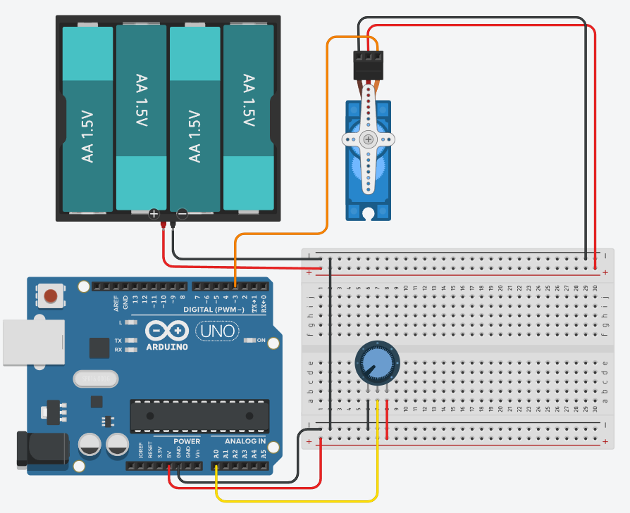

# Servomootorid

*Allikas: https://commons.wikimedia.org/wiki/File:Micro_servo.jpg*

Servomootorid on täpsed ja kontrollitavad mootorid, mida kasutatakse laialdaselt robootikas. Need koosnevad tavaliselt elektrimootorist, jõuülekandest, asendiandurist ja sisemisest juhtimisahelast. Sisemine tagasiside liigutab väljundvõlli etteantud nurga suunas ja hoiab seda seal, kuid tavaline hobiservo ei edasta tegelikku asendit Arduinole tagasi. Arduino UNO-ga saab servomootoreid juhtida korduvate juhtimpulsside abil, mille laius määrab soovitud asendi teatud vahemikus, tavaliselt 0–180 kraadi.

Arduino platvormil kasutatakse servomootorite juhtimiseks sageli Servo.h teeki, mis lihtsustab servo juhtimpulsside saatmist. Servomootori signaalijuhe ühendatakse Arduino digitaalviiguga. `Servo.h` teegi kasutamisel ei pea see olema PWM-tähisega viik. Servo toitejuhe ühendatakse servo tootja määratud pingega toiteallikaga. Välise toiteallika kasutamisel ühendatakse selle GND Arduino GND-ga. Juhtsignaali tüüpiline sagedus on 50 Hz ning impulsi laius varieerub umbes 1 ms (0°), 1,5 ms (90°) ja 2 ms (180°) vahel, kuigi täpne vahemik sõltub konkreetse mootori mudelist.

Lisaks tavalistele 0–180 kraadi servomootoritele on olemas ka pidevpöörlevad servod *(ingl Continuous Rotation Servo)*. Erinevalt tavalistest servodest ei kontrollita nende puhul asendit, vaid pöörlemiskiirust ja -suunda. Ligikaudu 1,5 ms laiuse juhtimpulsi korral jääb mootor paigale; lühem impulss (nt 1 ms) põhjustab pöörlemise ühes suunas ja pikem impulss (nt 2 ms) teises suunas, kusjuures kaugus neutraalsest signaalist määrab pöörlemiskiiruse. Täpne neutraalpunkt sõltub servo mudelist ja eksemplarist ning võib vajada katselist seadistamist. Sellised servod sobivad hästi rakendustesse, kus on vaja pidevat pöörlemist. [Näide pidevpöörleva servo kasutamisest Arduino UNO-ga](https://www.instructables.com/Continuous-Rotation-Servo-Arduino-UNO-a-Tutorial/)

Servomootoreid kasutatakse eelkõige rakendustes, kus on vaja täpset asendi kontrolli, näiteks robotkätes, kaugjuhitavates sõidukites, automaatikaseadmetes ja mehhanismides, mis vajavad täpset liikumist. Servo voolutarve sõltub koormusest ning võib olla suur nii liikumisel kui ka koormatud asendi hoidmisel. Suurim vool tekib tavaliselt siis, kui servo püüab liikuda, kuid selle võll on blokeeritud. Seetõttu võib servo jaoks vaja minna eraldi sobivat toiteallikat. Lisaks tuleb servomootori valikul arvestada pöördemomendiga, mida väljendatakse SI-süsteemis njuutonmeetrites (N·m); hobiservode andmetes kasutatakse sageli ka kilogrammjõud-sentimeetrit (kgf·cm).

## 180-kraadi pöörava mikro-servomootori juhtimine Arduino UNO-ga

Kuigi väikest SG90-tüüpi servomootorit on võimalik väikese koormuse korral toita Arduino UNO 5 V viigust, võib servo käivitamisel või suure koormuse all tekkida mitmesaja milliampri suurune voolutarve. Arduino 5 V viigust saadaolev vool sõltub plaadi toiteviisist ja teiste komponentide voolutarbest. Töökindlama lahenduse jaoks on soovitatav kasutada servo nõuetele vastavat eraldi 4,8–6 V toiteallikat ning ühendada selle GND Arduino GND-ga.

Juhtimiseks kasutame näites [Servo.h teeki](https://docs.arduino.cc/libraries/servo/).

~~~cpp
#include <Servo.h> //võtame kasutusele Servo teegi
#define signal 3 //juhime servot selle viigu kaudu
#define	pot A0 // potentsiomeetri väärtust loeme selle viigu kaudu

Servo mootor; //defineerime objekti mootor, mis tähistab meie servot

void setup()
{
  pinMode(signal, OUTPUT);
  Serial.begin(9600);
  mootor.attach(signal); // seome servoobjekti valitud juhtviiguga
}

void loop()
{
  int potData=analogRead(pot); //loeme potentsiomeetri väärtuse
  int mapData=map(potData,1023,0,0,180); //vastendame potentsiomeetri väärtuse vahemikku, mis sobib servo sisendiks
  mootor.write(mapData); //ütleme, kuhu servo peab liikuma
  delay(100);
  // kirjutame jadaporti viimati määratud sihtasendi
  Serial.print("Servo sihtasend: ");
  Serial.println(mootor.read());
}
~~~

**Märkus.** Servo tegelik liikumisulatus sõltub mudelist. Kui servo jõuab mehaanilise piirini, suriseb või kuumeneb, tuleb programmis kasutatavat nurgavahemikku vähendada.

**Märkus.** `mootor.read()` ei mõõda servo tegelikku füüsilist asendit, vaid tagastab viimati määratud sihtasendi.

[Interaktiivne simulatsioon](https://www.tinkercad.com/things/8kmlUSUWba2-servo?sharecode=01tIMfoiGNl4in-a598BpaKIN5A8n0fAhTA6ReHHnXw)
