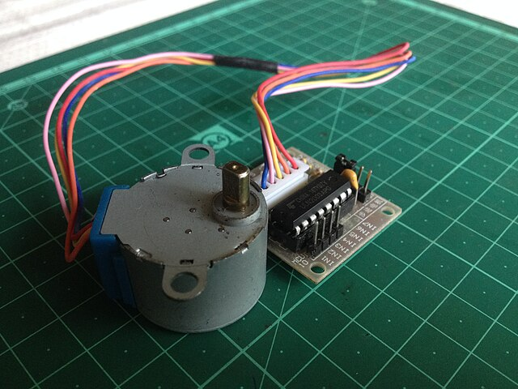
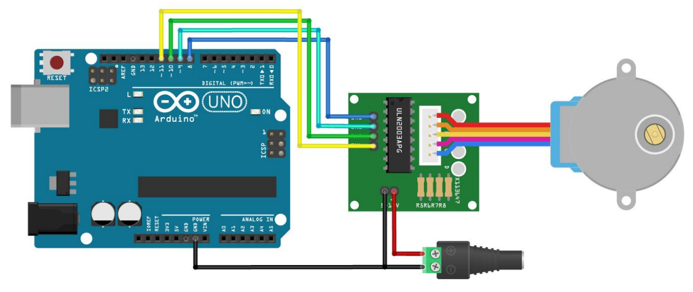
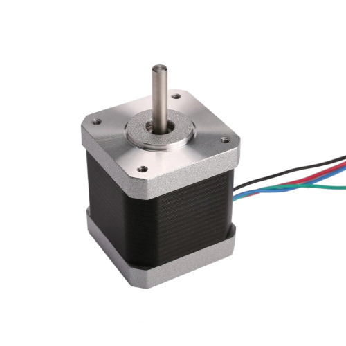
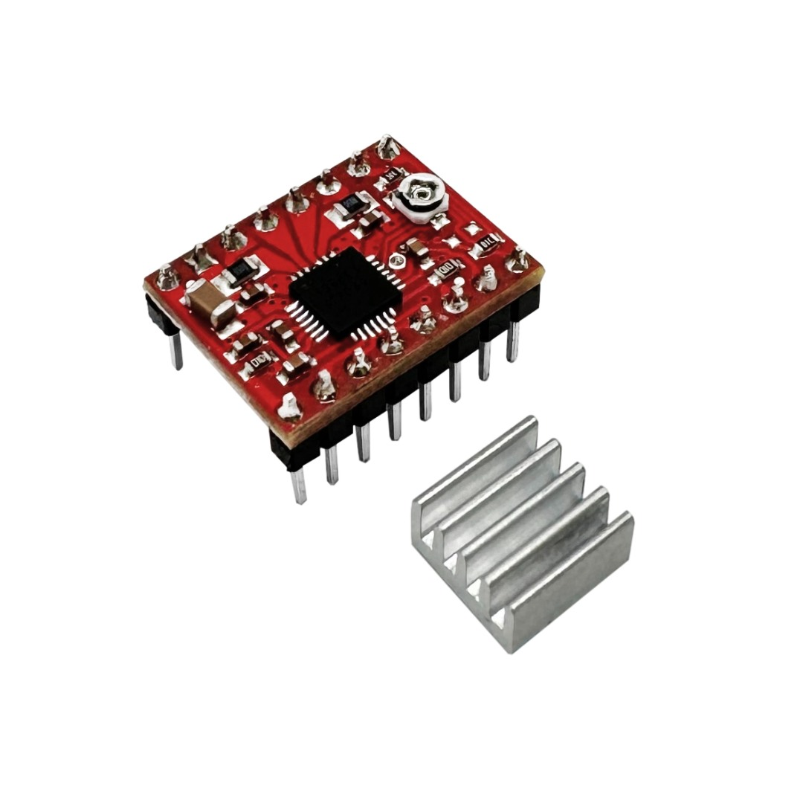

# Samm-mootorid


*Allikas: https://commons.wikimedia.org/wiki/File:28BYJ-48_unipolar_stepper_motor_with_ULN2003_driver.jpg*

Samm-mootorid *(ingl stepper-motor)* on elektrimootorid, mis liiguvad kindla nurga kaupa ehk sammudena, võimaldades täpset positsioneerimist ja kiiruse juhtimist. Neid kasutatakse näiteks 3D-printerites ja teistes automaatikaseadmetes, kus on vaja kontrollitud liikumist. Erinevalt tavalisest alalisvoolumootorist liigub samm-mootori võll diskreetsete nurksammudena. Kiiresti järjestatud sammud võimaldavad ka pidevat pöörlemist.

Arduino UNO-ga saab 28BYJ-48 tüüpi samm-mootorit juhtida ULN2003 draivermooduli abil. Arduino programm genereerib nelja digitaalviigu kaudu mähiste vajalikud lülitusjärjestused. ULN2003 lülitab nende signaalide järgi mootori mähiste voolu ning võimaldab mootorit toita sobivast eraldi toiteallikast, koormamata Arduino I/O-viike mootori vooluga.

Arduino UNO abil saab samm-mootorit juhtida näiteks `Stepper`- või `AccelStepper`-teegi abil. `Stepper`-teek sobib lihtsaks kindla kiirusega juhtimiseks. `AccelStepper` võimaldab lisaks kasutada kiirendust, aeglustust ja mitteblokeerivat liikumise juhtimist. Kuigi samm-mootorid on väga täpsed, võivad nad kaotada samme, kui koormus on liiga suur või kiirendus liiga järsk.

Tavaline samm-mootori juhtimine on avatud juhtimisahelaga: Arduino loendab antud sammukäske, kuid ei mõõda võlli tegelikku asendit. Absoluutse asendi leidmiseks pärast käivitamist või sammude kaotamist kasutatakse tavaliselt lõpulülitit või muud nullasendi andurit.

## 28BYJ-48 samm-mootori juhtimine ULN2003 draiveri ja Arduino UNO abil

28BYJ-48 on viie juhtmega unipolaarne neljafaasiline ja reduktoriga samm-mootor, mille nimipinge on 5 V. Mootori andmelehel on sisemise mootori sammunurgaks märgitud 5,625° ning reduktori nimisuhteks 1 : 64. Selles näites kasutab `Stepper.h` teek kahe samaaegselt aktiivse faasiga täissammujada, mille puhul vastab väljundvõlli ühele pöördele nominaalselt 2048 täissammu. Poolsammujada korral oleks samme nominaalselt 4096. Tegelik sammude arv ühe väljundvõlli pöörde kohta võib reduktori ehituse tõttu mudeliti veidi erineda, mistõttu tuleb täpsust nõudev süsteem kalibreerida.

Selle mootori juhtimiseks sobib hästi ULN2003 draiver, mis võimaldab ühendada lisatoiteallika ja juhtida mootorit nelja viigu abil.
Draiveriga suhtlemiseks kasutame `Stepper`-teeki.



**Märkus.** Selles näites tuleb ULN2003 moodul ühendada reguleeritud 5 V toiteallikaga, sest kasutatav 28BYJ-48 mootor on 5 V mudel. Välise toiteallika GND tuleb ühendada Arduino GND-ga.

~~~cpp
#include <Stepper.h> //võtame kasutusele Stepper teegi
#define in1 8
#define in2 9
#define in3 10
#define in4 11

const int SAMME_POORDE_KOHTA = 2048; // nominaalne täissammude arv ühe väljundvõlli pöörde kohta
Stepper mootor = Stepper(SAMME_POORDE_KOHTA, in1, in3, in2, in4);
// Järjestus in1, in3, in2, in4 vastab selle mootori mähiste lülitusjärjestusele

void setup() {
}

void loop() {
	//teeme 1 täispöörde päripäeva, kiirusega 10 sekundit pööre
	mootor.setSpeed(6); //kiirus on pööret/minutis
	mootor.step(SAMME_POORDE_KOHTA); //see on blokeeriv funktsioon

	//teeme 2 täispööret vastupäeva kiirusega 5 sekundit pööre
	mootor.setSpeed(12);
	mootor.step(SAMME_POORDE_KOHTA * -2);
}
~~~~

**Märkus.** Pärast `step()` käsu lõppu jäävad mootori mähised pingestatuks. Kui hoidemomenti pole pausi ajal vaja, võib kõik neli juhtviiku pärast liikumist seada olekusse `LOW`; sel juhul saab võlli vabamalt liigutada ja asend ei ole enam hoitud.

See koodinäide põhineb [pikemal ja detailsemal õpetusel](https://lastminuteengineers.com/28byj48-stepper-motor-arduino-tutorial/), mida soovitan tungivalt lugeda.

## 42BJ3430-22A samm-mootori juhtimine A4988 draiveri ja Arduino UNO abil

|  |  |
|------------------------|---------------------------------|

NEMA 17 tähistab mootori korpuse ja kinnitusmõõtmete klassi, mitte nimipinget, faasivoolu ega sammunurka. Draiveri seadistamisel tuleb lähtuda konkreetse mootorimudeli andmetest.

Selles näites kasutatava [WOOWAIR-i mootorikomplekti](https://www.amazon.de/dp/B0FXMDVS6S?th=1) tootekood on DRR-2W-171 ning mootori korpusele on märgitud `42BJ3430-22A`. Müüja avaldatud andmed on järgmised:

| Omadus | Väärtus |
|:---|:---|
| Mootori tüüp | Kahefaasiline neljajuhtmeline bipolaarne NEMA 17 samm-mootor |
| Sammunurk | 1,8° ehk 200 täissammu pöörde kohta |
| Nimivool | 1,5 A faasi kohta |
| Faasitakistus | 2,7 Ω |
| Faasi induktiivsus | 4,7 mH |
| Mähise arvutuslik nimipinge | Umbes 4,1 V, sest 1,5 A × 2,7 Ω ≈ 4,05 V |
| Hoiudemoment | Tootenimetuses 2,2 kgf·cm ehk umbes 0,22 N·m; tehnilisel tootepildil vähemalt 0,29 N·m |
| Fikseerimismoment | 20 mN·m |
| Mootori mõõtmed | 42 × 42 × 34 mm |
| Võll | 5 mm D-kujuline võll, väljaulatuv pikkus 15 ± 0,25 mm |
| Kinnitusavad | 4 × M3, avade vahekaugus 31 ± 0,1 mm |
| Mootoripoolne pistik | PH2.0, kuuekohaline korpus nelja kasutatava kontaktiga |

Müüja tootenimetuses ja tehnilisel tootepildil esitatud hoidemomendid ei lange kokku ning sellele mootorile ei ole leitud eraldiseisvat tootja andmelehte. Seetõttu ei tohiks suuremat, 0,29 N·m väärtust käsitleda kontrollitud miinimumnäitajana. Õppetöös on mõistlik lähtuda konservatiivsest väärtusest 2,2 kgf·cm ehk umbes 0,22 N·m.

### Voolupiirangu seadistamine

Enne mootori käivitamist tuleb A4988 voolupiirang seadistada mootori ja konkreetse draivermooduli järgi. 42BJ3430-22A nimivool on müüja andmetel 1,5 A faasi kohta. See on mootori suurim nimivool, mitte vool, mille iga A4988 moodul suudab pidevalt ja ohutult anda. Sobiv VREF-pinge sõltub draivermoodulil kasutatud mõõtetakistitest, mistõttu ei saa kõigile A4988 moodulitele kasutada üht universaalset VREF-väärtust. Seadistamisel tuleb järgida konkreetse mooduli tootja juhendit.

Draivermooduli lubatud voolu ja jahutusvajadust tuleb kontrollida eraldi. 1,5 A faasivool nõuab tavaliselt A4988 mooduli head jahutust ning võib olenevalt moodulist vajada nii jahutusradiaatorit kui ka sundjahutust. Õppetöös võib voolupiirangu seada väiksemaks, kui mootor annab koormuse liigutamiseks piisavalt momenti. Toiteallikast mõõdetud vool ei võrdu mootori ühe mähise vooluga.

### Toide

Arduino ja A4988 peavad kasutama **ühist GND**-d.

| A4988 viik             | Kuhu ühendada                   |
|------------------------|---------------------------------|
| VMOT                   | 12 V toite **+**                |
| GND (VMOT kõrval)      | 12 V toite **–** ja Arduino GND |
| VDD                    | Arduino **5 V**                 |
| GND (VDD kõrval)       | Arduino **GND**                 |

A4988 kasutab voolupiiranguga impulssjuhtimist, mistõttu võib draiveri VMOT-toitepinge olla mootori mähise arvutuslikust pingest kõrgem. See eeldab õigesti seadistatud voolupiirangut. Mootorit ei tohi ühendada otse 12 V toiteallikaga.

**NB!** Ühenda VMOT- ja GND-viigu vahele võimalikult A4988 mooduli lähedale vähemalt 47 µF elektrolüütkondensaator. Kondensaatori pluss ühendatakse VMOT-viiguga ja miinus GND-ga. 12 V toite korral peab kondensaatori nimipinge olema sellest piisavalt suurem, näiteks vähemalt 25 V. Hoia mootori toitejuhtmed võimalikult lühikesed.

### Juhtsignaalid A4988 ↔ Arduino

| A4988 viik | Arduino UNO viik |
|-----------|-----------------|
| STEP      | D2              |
| DIR       | D3              |
| ENABLE    | GND (draiver kogu aeg sisselülitatud) |
| RESET     | Arduino 5 V ehk VDD, kui lähtestamist eraldi ei juhita |
| SLEEP     | Arduino 5 V ehk VDD, kui unerežiimi eraldi ei juhita |
| MS1, MS2 ja MS3 | GND (täissammurežiim) |

Kui MS1, MS2 ja MS3 on madalal loogikatasemel, töötab A4988 täissammurežiimis ning 1,8° sammunurgaga mootor teeb ühe pöörde 200 sammuga.

**Märkus.** Kui ENABLE on ühendatud GND-ga, on A4988 väljundid pidevalt aktiivsed ning mootor hoiab asendit ka pauside ajal. See põhjustab voolutarvet ja mootori soojenemist. Kui hoidemomenti pole vaja, võib ENABLE-viigu ühendada Arduino digitaalviiguga ning seada selle pauside ajaks olekusse `HIGH`. ENABLE on aktiivne madala loogikatasemega.

### Samm-mootori juhtmete ühendamine

**NB!** Ära ühenda ega eemalda samm-mootori juhtmeid ning ära muuda mähiste ühendusi ajal, mil A4988 on pingestatud. Enne ühenduste muutmist lahuta nii mootori väline toiteallikas kui ka Arduino USB- või muu toide.

42BJ3430-22A on **4-juhtmeline bipolaarne** samm-mootor. Müüja ühendusskeemi järgi on punane ja sinine juhe ühe mähise ning roheline ja must juhe teise mähise otsad. Kuna müüja hoiatab, et kaablite värvijärjestus võib erineda, tuleb mähisepaarid enne A4988-ga ühendamist multimeetriga üle kontrollida.

Mähisepaarid saab leida multimeetri abil (takistuse mõõtmine):

1. Kontrolli, kas punase ja sinise juhtme vahel on takistus umbes **2,7 Ω** → **mähis A**.
2. Kontrolli, kas rohelise ja musta juhtme vahel on samuti umbes **2,7 Ω** → **mähis B**.
3. Eri mähistesse kuuluvate juhtmete vahel ei tohiks multimeeter elektrilist ühendust näidata.

Oluline on leida kaks omavahel ühendatud väikese takistusega juhtmepaari. Mõõdetud väärtus ei pea olema täpselt 2,7 Ω, sest tulemust mõjutavad mootori eksemplar ning multimeetri mõõtejuhtmete ja kontaktide takistus. Kui värvid ei vasta siin kirjeldatule, lähtu mõõdetud mähisepaaridest, mitte juhtmete värvist.

Seejärel ühenda:

| A4988 viik | Mootorijuhe müüja skeemi järgi |
|-----------|-------------------------------|
| 1A        | punane, mähis A+              |
| 1B        | sinine, mähis A−              |
| 2A        | roheline, mähis B+             |
| 2B        | must, mähis B−                 |

Kui mootor ainult vibreerib ega pöörle, on vähemalt ühte A4988 väljundipaari tõenäoliselt ühendatud eri mähiste juhtmed. Mõõda mähisepaarid uuesti ja ühenda ühe mähise otsad viikudele 1A–1B ning teise mähise otsad viikudele 2A–2B.
Kui pöörleb “vales” suunas, saab suunda muuta kas:

- koodis (DIR-viik `HIGH` ↔ `LOW`),
- või vahetades ühe mähise juhtmete järjekorra (1A ↔ 1B).

### Näiteskood (Arduino)

Mootori sammusuund: 1,8° samm → **200 täissammu** ühe pöörde kohta.

```cpp
// 42BJ3430-22A + A4988 + Arduino UNO

// A4988 juhtsignaalid
const int STEP_PIN = 2;   // STEP → Arduino D2
const int DIR_PIN  = 3;   // DIR  → Arduino D3

// Mootori parameetrid (täissamm)
const int STEPS_PER_REV = 200;   // 1.8° samm → 360° / 1.8° = 200 sammu
const int STEP_DELAY_US = 5000;  // 5000 µs HIGH + 5000 µs LOW → u 30 p/min

// Abifunktsioon ühe suuna sammude tegemiseks
void stepMotor(int steps, bool directionClockwise) {
  // Määrame suuna (HIGH või LOW)
  digitalWrite(DIR_PIN, directionClockwise ? HIGH : LOW);

  // Teeme etteantud arvu samme
  for (int i = 0; i < steps; i++) {
    digitalWrite(STEP_PIN, HIGH);
    delayMicroseconds(STEP_DELAY_US);   // impulsi "HIGH" aeg
    digitalWrite(STEP_PIN, LOW);
    delayMicroseconds(STEP_DELAY_US);   // impulsi "LOW" aeg
  }
}

void setup() {
  pinMode(STEP_PIN, OUTPUT);
  pinMode(DIR_PIN, OUTPUT);

  // Soovi korral võib algsuuna fikseerida
  digitalWrite(DIR_PIN, LOW);
}

void loop() {
  // 1 täispööre päripäeva
  stepMotor(STEPS_PER_REV, true);
  delay(1000);  // 1 s paus

  // 1 täispööre vastupäeva
  stepMotor(STEPS_PER_REV, false);
  delay(1000);  // 1 s paus
}
```

Näide ei kasuta kiirendust. Suurema kiiruse või koormuse korral tuleb sammude sagedust suurendada järk-järgult või kasutada kiirendust toetavat teeki, näiteks AccelStepperit.

